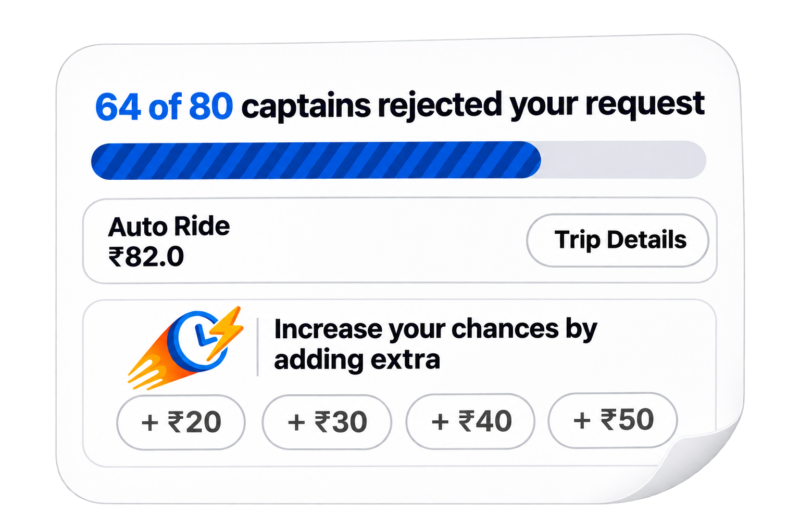
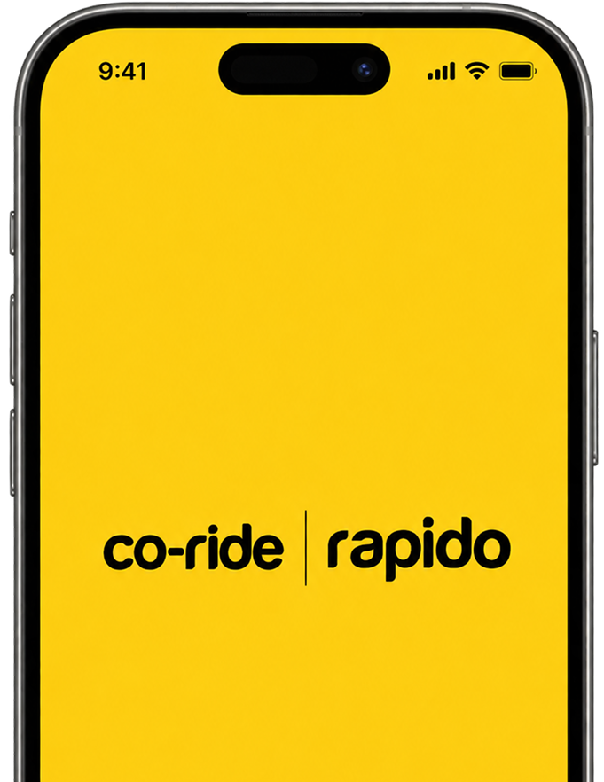

<h1 align="center">Co-Ride × Rapido</h1>

<p align="center">
  <strong>Community-Powered Ride Sharing Integrated into the Rapido Ecosystem</strong>
</p>

<p align="center">
  <a href="#the-vision">Vision</a> •
  <a href="#the-problem">The Problem</a> •
  <a href="#the-solution">The Solution</a> •
  <a href="#key-features">Key Features</a> •
  <a href="#business-impact">Business Impact</a> •
  <a href="#interactive-prototype">Interactive Prototype</a> •
  <a href="#getting-started">Run Locally</a>
</p>

---

## 🚀 The Vision

> *"One person searching for a ride. Another driving with an empty seat. What if we connected them?"*  
> **Your route. My route. Our ride.**

**Co-Ride** is an end-to-end product concept exploring how Rapido can introduce community-powered ride sharing to tackle daily commuting challenges. By pairing everyday commuters travelling along overlapping routes, Co-Ride bridges the gap between unmatched riders and vehicle owners with unused seat capacity.

---

## 🛑 The Problem

<p align="center">
  
</p>

Getting from point A to point B during peak hours has become increasingly difficult:
- **Frequent Cancellations & Rejections**: Commuters often experience repeated rejections (e.g., *"64 of 80 captains rejected your request"*).
- **Uncertain Wait Times**: Surge pricing, captain shortages, and route mismatch leave riders stranded.
- **Unused Vehicle Capacity**: Thousands of private vehicles and daily commuters travel with empty seats on the exact same roads at the exact same times.
- **The Core Insight**: The challenge is not an inherent shortage of vehicles—it's a lack of connection between people travelling in the same direction.

---

## 💡 The Solution

<p align="center">
  
</p>

Instead of introducing a detached or complicated new app, **Co-Ride** is seamlessly integrated into Rapido's familiar booking experience:
1. **Volunteers (Drivers)**: Verified vehicle owners can share their everyday commute, cover fuel costs, and make trips productive.
2. **Joiners (Passengers)**: Commuters facing repeated booking rejections can instantly join a verified volunteer travelling along their route.

---

## 🔑 Key Features

### 1. Trust & Verification (DigiLocker Integration)
- Volunteers register by uploading driving licenses and vehicle registration certificates.
- Instant, government-grade identity and document verification powered by **DigiLocker**.
- Verified badge establishes immediate trust within the community.

### 2. Women-Only Rides Preference
- A dedicated filter enabling female commuters to connect, share journeys, and travel with female volunteers.
- Provides enhanced comfort, peace of mind, and security during daily transit.

### 3. Effortless Ride Publishing & OTP Verification
- Volunteers select destination, available seats, and vehicle.
- Pre-set contribution suggestions keep pricing transparent and affordable.
- 4-digit PIN / OTP verification confirms passenger identity before starting the trip.

### 4. Smart Alternative Discovery
- If a standard Rapido Captain request remains unmatched, Co-Ride automatically surfaces nearby verified volunteers travelling along the exact route.
- No need to cancel, restart search, or re-enter pickup/drop-off destinations.

---

## 📈 Business Impact & Shared Value

- **Commuters**: Reliable, cost-effective alternative during peak cancellation hours.
- **Volunteers**: Fair cost-sharing that helps offset everyday fuel and maintenance expenses.
- **Rapido**: A sustainable platform fee per completed shared trip, unlocking an entirely new revenue stream without adding new vehicles to already congested roads.

---

## 🎨 Interactive Prototype & Design Architecture

The repository includes a production-ready interactive presentation built with modern web technologies:
- **10 Curated Sections**: Alternating between signature Rapido Gold (`#ffca20`) and clean white.
- **Viewport-Responsive Layout**: Dynamically fits screens from mobile viewports to 1080p, 1440p, and 4K displays with zero unwanted vertical overflow.
- **Smooth Snapping & Keyboard Navigation**: Use `↓` / `Page Down` and `↑` / `Page Up` to transition slide-by-slide.
- **Embedded Interactive Walkthrough**: Full design presentation video walkthrough.

---

## 💻 Getting Started (Run Locally)

### Prerequisites
- Any modern web browser (Chrome, Edge, Firefox, Safari)
- Optional: Node.js / `live-server` for hot reloading

### Quick Run
1. Clone the repository:
   ```bash
   git clone https://github.com/tandonrishav18/co-ride.git
   cd co-ride
   ```

2. Open the prototype:
   - Double-click `dist/index.html` to open directly in your browser.
   - Or start a local live server:
     ```bash
     npx live-server dist --port=5500
     ```
   - Open **[http://127.0.0.1:5500](http://127.0.0.1:5500)** in your browser.

---

## 📂 Repository Structure

```
co-ride/
├── dist/
│   ├── index.html            # Main 10-section interactive prototype presentation
│   ├── design.css            # Responsive layout & typography styles
│   ├── phone-reveal.js       # Interactive UI reveal transitions
│   ├── stickers.js           # Rejection sticker collage animations
│   ├── video.js              # Video walkthrough player controls
│   └── assets/               # Production mockups, icons, fonts & video walkthrough
├── 1.png ... 21.png          # High-resolution screen mockups
├── co.png                    # Splash screen mockup
└── README.md                 # Project documentation
```

---

## 👤 Author

**Rishav Tandon**  
GitHub: [@tandonrishav18](https://github.com/tandonrishav18)

---

<p align="center">
  <sub>Because sometimes, the ride you need is already on its way.</sub>
</p>
